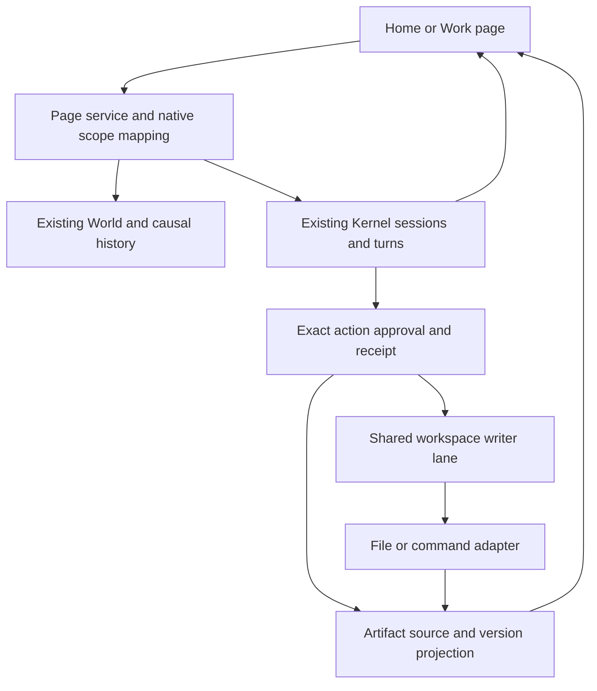

# Per Pulse core harness foundation

Phase checkpoint: 2026-10-23. Baseline: `bde8aa888ed4415b33e3f1f9414cd8ac99e7440b`, `feat/english-session-pages`. The work targets `Lightmaze/Per-Pulse`; the older Pulse repository is source lineage, not a second product to modify.

**Decision:** build the product on the existing World, Home/Work and Harness Kernel. The code already contains durable sessions, action authority, recovery, model transport and work coordination. The immediate missing foundation was their usable product connection: users could send work but could not review a proposed file effect, stop its exact turn or inspect the resulting file with its source. A second agent loop or task database would make these guarantees harder to maintain.

This phase connects those controls, adds source-bound text artifacts, and coordinates cooperating workspace writers. It also records the remaining modules needed for unattended work. It does not establish complete parity with any reference product or claim live-model quality.

## Evidence and reverse engineering limits

The research covers Claude Duet, ChatGPT dots, Meta Muse and xAI Grok Bot, using first-party public documentation. Documented behavior, disclosed implementation and proposed Per Pulse design are labeled separately in the companion reports. No proprietary source, private prompts or signed-in product sessions were inspected. Public behavior can establish a required contract; it cannot establish an undisclosed database schema, exact scheduler or memory algorithm.

| Reference | What the source establishes | Transfer to Per Pulse |
| --- | --- | --- |
| [Claude Duet](https://claude.com/resources/articles/claude-duet) and [product help](https://support.claude.com/en/articles/17631495-get-started-with-claude-duet) | A continuing main conversation, focused topics, tasks, editable outputs and decisions that can wait. User completion is distinct from the agent suggesting completion. | Distinguish ongoing responsibility, work context, run completion, result delivery and user acceptance. |
| [ChatGPT dots](https://learn.chatgpt.com/docs/dots) and [controls](https://learn.chatgpt.com/docs/dots/controls) | Foreground interaction continues alongside background work. Task-specific context, environment binding and different pause/stop/schedule controls are documented. Proactive research has narrower authority. | Scope controls to exact work; preserve original environment and context provenance; separate observation from effect permission. |
| [Muse security design](https://research.meta.ai/blog/security-and-safety-for-ai-agents-our-approach-with-muse) | Published implementation separates the Hatch agent cell from host-side authority, credential and browser services; durable state is outside the replaceable execution cell. | The model proposes actions; a separate authority boundary checks them. Environment replacement must not replace work identity or erase outcome uncertainty. |
| [Grok Bot](https://docs.x.ai/grok-bot/overview), [computer use](https://docs.x.ai/grok-bot/computer-and-apps) and [approvals](https://docs.x.ai/grok-bot/approvals-security-and-privacy) | Independent Bot contexts share account resources; a screen permits one computer-use task at a time. Approval expiry does not become permission to execute later. | Logical context separation does not prevent shared-resource races. Expired actions and changed policies must not silently revive an old effect. |

Detailed sources and evidence: [Duet/dot](research/duet-dot.md), [Muse/Grok Bot](research/muse-grokbot.md), [Duet/dot evidence JSON](research/evidence-duet-dot.json), [Muse/Grok evidence JSON](research/evidence-muse-grokbot.json), and [native code audit](research/native-harness-audit.md).

## The necessary identities

| Identity | Meaning and rule |
| --- | --- |
| Subject / Engram lineage | The continuing owner of history, learned state and ongoing work. Creating a page does not create another subject. |
| Context / Page | Home or a focused native Work context. A link selects existing context; it does not copy all other histories. |
| Work / Intent | The continuing responsibility, dependencies and requested result. A successful model reply is not necessarily completed work. |
| Session / Turn | Durable execution history and a particular admitted activation. Stop targets the exact turn, not the entire subject. |
| Action / Approval | A proposed effect and its concrete authority. Ownership, original attachment, input and expiration govern dispatch. |
| Environment / Resource | Where the effect occurs and what it contends for. Different contexts can share a filesystem or browser. |
| Artifact / Version | The result's source action, work context and content digest. A path alone is not a version. |
| Trigger / Input | The origin and identity of a user instruction, event or scheduled activation. Retrying delivery must not fabricate another human request. |
| Memory / Skill revision | The evidence or method selected for an activation, with revision and provenance. Revoking access is different from deleting retained content. |

## Module map and priority

These are responsibilities, not a proposal for separate microservices. “Required” means needed for dependable continuing work; some required modules are inherited, some now connected, and some still need implementation. P0 is the current ordinary-work path; P1 gates broader unattended use.

| Module | Priority | Existing anchor and phase status | Acceptance contract / next gap |
| --- | --- | --- | --- |
| Durable identity, events and ownership | Required / P0 | Native World, causal events, Engram lineage, `HarnessScope`; reused. | Read and control a page through its native scope. Browser input cannot choose another session/owner. |
| Work admission and context routing | Required / P0 | Native Home/Work and `PageService`; reused. | Accepted input persists and reaches its intended context. Explicit intent revisions and queued-input cancellation remain to expose. |
| Context assembly and memory provenance | Required / P0–P1 | Existing context/history tools and local state; inherited, partial product exposure. | Preserve source identities through selection/compaction; add inspectable context revisions and user memory correction. |
| Supervisor, progress and scoped control | Required / P0 | `PageExecution`, page API/UI; connected this phase. | Stop only the named turn, even during approval continuation or offline recovery. Live semantic steering remains separate from queued next input. |
| Tool catalog and capability boundary | Required / P0 | Native tool descriptors/providers and read-only profile; reused. | Unsupported or unauthorized tools fail explicitly. Read-only Work/team descriptions should advertise only enabled operations. |
| Effect authority, receipts and recovery | Required / P0 | Native action/approval records; product controls connected. | Original-action allow/deny, no duplicate execution on retry, explicit uncertain effects, completed effect separated from failed continuation. |
| Environment and resource coordination | Required / P0–P1 | Existing workspace/command adapters; shared writer lane added. | Conflicting cooperating writes serialize while reads and unrelated work proceed. Browser leases and cross-process isolation remain separate. |
| Artifacts, delivery and acceptance | Required / P0–P1 | `PageArtifacts` projects successful native file actions, previews and complete verified text downloads. Existing selected Return Home remains. | Verify source and digest before delivery. Immutable revisions, binary files, uploads and delivery/acceptance state remain. |
| Usage, budget and admission | Required before unattended work / P1 | Native usage evidence and in-memory runtime budgeting exist. | Add durable reservations, settlement, per-work envelopes and explicit exhaustion. Existing counters are not restart-safe spending limits. |
| Trigger and schedule admission | Required for unattended work / P1 | Native runtime activation; no new cron loop added. | Admit events through the same causal path with owner, deduplication, timezone, revision, environment and budget. |
| Attention and notification delivery | Important / P1 | Page waiting indicators and visible background refresh added. Native work reports exist. | Separate actionable waits, ordinary results, unread activity and delivery acknowledgement; avoid tool-event notification spam. |
| Native browser/connector broker | Important / P1 | Not wired into this product's actual native catalog. | Implement one environment-bound adapter with host-held credentials, takeover and independently checked effects. |
| Worker coordination and mailbox | Important / P1 | Native Work/team and durable reporting/outbox exist. | Preserve owner, deliverable, source, acceptance and reply destination; child completion does not close the parent automatically. |
| Memory revision/deletion and skill versions | Important / P1 | History/local-state foundations exist; product lifecycle incomplete. | Record revisions and selection; distinguish future access revoke, derived-memory deletion, source deletion and subject deletion. |
| Trace, replay and evaluation | Important / P1 | Native action/model/causal records; new deterministic integration tests. | Correlate input, model, environment, effect and artifact. Replay observation safely; never replay an external effect merely to reconstruct history. |

## Implemented path

`PageExecution.snapshot` only observes existing records. It does not create a runner or wake a model. A page maps through its native center to `work:
`; Home uses the existing Home scope. Exact action/turn IDs are validated inside that scope. Per-action and per-turn control locks leave unrelated controls independent. A slow model continuation after approval cannot hold the Stop button hostage.

`PageArtifacts` projects confirmed successful `mutate_file` receipts. A click verifies a regular UTF-8 file within the original workspace, with no-follow/identity checks, a 1 MiB file bound and 64 KiB preview bound. The recorded digest must match. A changed file produces a changed-state explanation, never the replacement content presented as the original version. Sensitive values are redacted. The list performs no file-content I/O. There is no second artifact database or implicit immutable blob store.

`GET /api/pages/{pageId}/artifacts/{actionId}/download` resolves the same native
receipt and reads the complete file again through `WorkspaceFiles`. It returns
only bytes matching that recorded digest and needing no redaction. Responses
use `application/octet-stream`, attachment disposition with an encoded UTF-8
basename and ASCII fallback, the SHA-256 as ETag, and the existing no-store and
nosniff headers. HTTP sends the checked in-memory bytes rather than reopening
the pathname. The client verifies their digest before starting a download and
cancels a pending save when the user closes the preview or leaves its Work.
The download neither creates a model call nor replays a native file action.
The 1 MiB read bound is distinct from the native adapter's current 64 KiB
write-output bound; this change does not enlarge either. Older overwritten
versions are still unavailable without a separate immutable-version feature.

When native succession moves a Work to its next generation, confirmed file
receipts and uncertain action evidence remain observable through that Work's
verified committed lineage. This reader preserves the same World and context,
excludes delegated histories, and applies one list bound across generations.
It works before a successor Kernel session exists and after restart without
creating a session or making a model call. Old action IDs do not become new
approvals or cancellation targets. Unverifiable ancestry fails closed.

The shared resource registry coordinates a workspace's participating file writes, restores and commands across native contexts in this process. Waiting is cancellation-aware and deadline-bounded. Reads do not wait for the writer lane. Command cleanup belongs to the effect lifetime; an unresolved cleanup must remain visible and must not authorize a second overlapping writer. This is not an operating-system filesystem lock or protection against arbitrary external writers.

## Control semantics that must stay distinct

| User operation | Current behavior |
| --- | --- |
| Send a message while work runs | Durable input for ordinary native dispatch. This phase does not promise immediate mid-turn semantic steering. |
| Stop this turn | Cancel the exact admitted turn, preserve completed effects and uncertainty, leave other contexts and later queued input intact. |
| Allow once | Decide one original eligible action. Repeating the same decision returns observation, without resuming or repeating its effect. |
| Decline | Reject that action; normal native continuation may explain or proceed with different work. |
| Open a file result | Check the recorded version when opened. This is not live content polling or old-version restoration. |
| Download a file result | Recheck and deliver exact current bytes matching the original receipt; refuse changed, unavailable or redacted content. |
| Pause work / cancel a schedule / revoke access | Distinct future product controls; not aliases for Stop this turn. |

If an approved write succeeds and the following model response fails, the receipt reports `actionCompleted: true` and a separate continuation error. Users must not be invited to repeat a completed external effect to repair a conversational failure.

## Bounded native file receipts

Large file diffs used to consume the entire native payload allowance before
the receipt's metadata and JSON escaping were counted. A successful write could
therefore lose its file source and block model continuation. The workspace
adapter now bounds only the diff preview against the complete tool-result
envelope. Exact action, operation, change, checkpoint, workspace and file
digests remain intact. The diff has explicit truncation/redaction flags and
its full digest; the original approved file remains digest-verifiable.

The same bound applies to `read_file` excerpts, including multibyte characters,
escaped text and long provider call IDs. If even a compact mutation receipt
cannot fit, the adapter rejects it before creating an operation or writing a
file. Store limits, approvals, credential checks and file-size limits retain
their existing semantics. Earlier already-truncated receipts are not repaired
from current file contents, and uncertain effects are not upgraded to success.

## Preserve what makes Pulse different

Per Pulse aims at a globally continuous Context Body with local activation across different timescales. Durable transcripts, scheduled jobs and crash recovery are useful operational components; they alone do not define that continuity. Home is a foreground projection of the same evolving world, not an unbounded master prompt. A local activation should retain subject lineage, causal input, selected evidence, dependencies and current intent; its result can change later routing, memory, practice and work.

The next substantive test is a shared ongoing goal with two focused contexts: one receives a correction while another produces relevant evidence; a later activation uses both by source references, preserves changed intent and produces an inspectable result. A slower review process retains its ownership through foreground interruptions. A corrected procedure changes later execution with the old method, feedback and revised method still explainable. These tests should use the existing Pulse mechanisms rather than introducing a parallel task scheduler to imitate product terminology.

## Next phase, in order

1. Run an explicitly configured real-provider acceptance task through approval, artifact readback, concurrent Home and restart; record actual usage and model/tool protocol failures. Synthetic transports prove control contracts, not model performance.
2. Add durable budget reservations and exhaustion behavior before exposing unattended recurring work. Reserve across concurrent contexts before dispatch; settle actual usage and retain uncertainty after interruption.
3. Expose genuine input revision/steering and queued-input controls, with safe-point acknowledgement and invalidation of stale unexecuted proposals.
4. Extend artifacts through native change APIs: immutable selected versions, binary delivery and explicit acceptance.
5. Implement one native browser or connector broker, then event/routine adapters on the same World admission path. Keep resource ownership, credentials, grants and work identity distinct.

Cloud account hosting, rich remote desktop, marketplaces, avatars and broad channel parity can follow these contracts. They are not prerequisites for shipping this local phase.

## Verification and limits

The phase uses real World/Kernel persistence, approval resolution, file effects and HTTP/UI integration with explicitly synthetic model and command transports. See [the phase verification record](harness-verification.md) for exact commands and results. No live provider, external account action or real Docker execution is claimed. The product remains a single-user loopback alpha.
